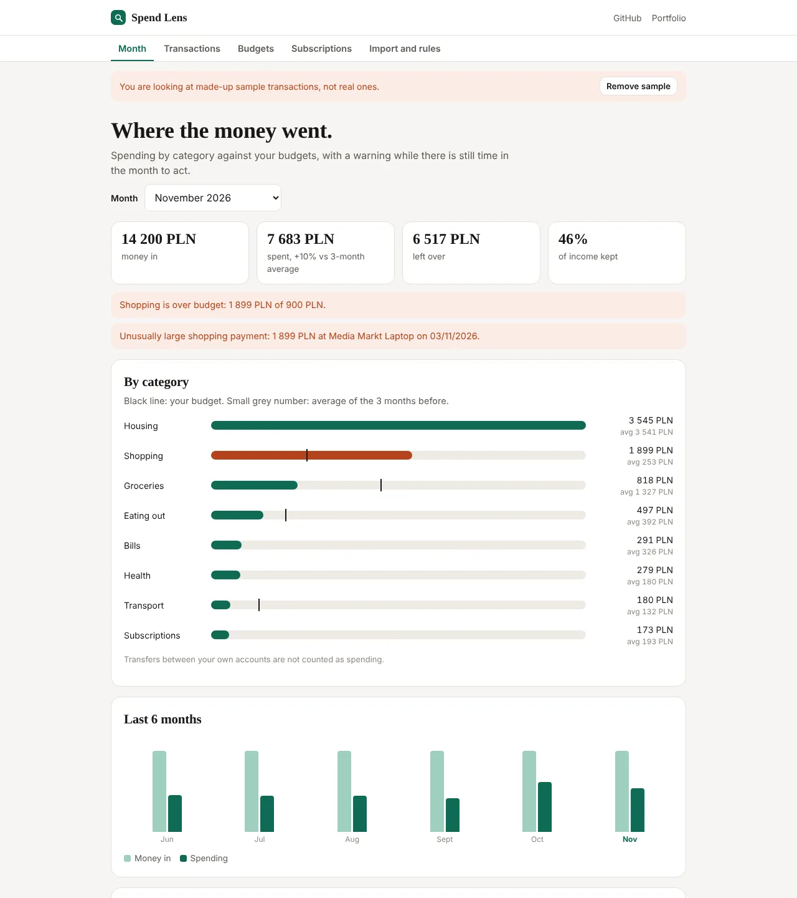

# Spend Lens

**Import your bank's CSV export and see where the money goes: automatic categories you can teach, monthly budgets with early warnings, and subscriptions found for you. Nothing leaves your browser.**

**Current version:** 0.1.0

Live app: https://kostasxeras.com/spend-lens/



## Why this exists

Banking apps show a list of transactions and a pie chart. They rarely tell you, on the 18th, that groceries are on pace to go over, or that you pay for six subscriptions. Budgeting apps that do this want your bank login. Many people would rather not give that to anyone.

## Who it is for

- People who want to understand their spending without connecting their bank to a third party
- Couples planning a budget from a joint account export
- Anyone in Poland whose bank exports CSV with Polish column names

## What it does

- **Import:** any bank CSV. Polish and English column names are recognised, as are UTF-8 and Windows-1250 files, lines above the header, semicolons, "1 234,56" amounts, and separate money out and money in columns. A preview shows what will be imported. Importing the same file twice adds nothing.
- **Categories:** built-in rules for common shops and services in Poland, and your own rules first. Change a category once, choose "Yes, remember", and it applies to past and future payments at that place.
- **Month:** money in, spending, left over and share kept, against the 3-month average. Spending by category against budgets, a 6-month chart and the biggest places.
- **Early warnings:** a category over budget, a category on pace to go over by month end, and unusually large payments.
- **Budgets:** a limit per category, with your own averages as hints and one tap to fill them.
- **Subscriptions:** regular payments found by pattern (same place, at least 3 of the last 6 months, similar amount), with the monthly and yearly cost.
- **Data:** export with categories as CSV, JSON backup and restore, and made-up sample data, clearly marked.

## Privacy

Your file is read in the browser and stored in its local storage. There is no account and no server of mine. Nothing is sent anywhere. Clearing your browser data deletes it.

Not financial advice.

## Decisions

- [Import CSV exports, never ask for a bank login](docs/decisions/0001-csv-not-bank-login.md)
- [Categorise with rules the user can see and edit, not a model](docs/decisions/0002-rules-you-can-see.md)
- [Warn when a category is on pace to go over, not only when it is over](docs/decisions/0003-warn-on-pace-not-only-over.md)

## How I would measure success

No usage data yet. These are the measures I would track, with targets to set after a first month of use.

| Measure | Definition | Target |
|---|---|---|
| Coverage | Share of spending left in Other after the first import, and after a month of corrections | [x]% |
| Return use | Share of users who import a second month | [x]% |
| Action | Share of users who change or cancel at least one regular payment found | [x]% |

## What I would do next

1. Split a payment across categories
2. Shared budgets for two people from two exports
3. Better place names with a small dictionary of Polish card descriptors

## My role

I defined the problem, the users, the features and the decisions. The idea started from an example in Justin McKelvey's list of project ideas, which I turned into a full app with my own product choices. Screenshots use the app's made-up sample data.

## Run it yourself

One HTML page and one stylesheet, with no build step. Open `index.html` through any local web server, for example `python3 -m http.server`, then go to http://localhost:8000.

## Repo layout

```
index.html               The app
app.css                  Shared base styles
docs/product-brief.md    Problem, users, goals, scope
docs/case-study.md       Approach, decisions, what to measure, next steps
docs/decisions/          One record per real tradeoff
docs/screenshots/        Desktop and mobile
```
